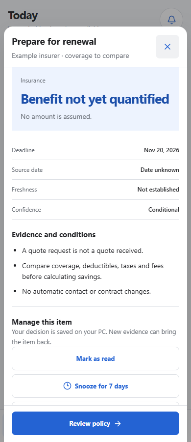
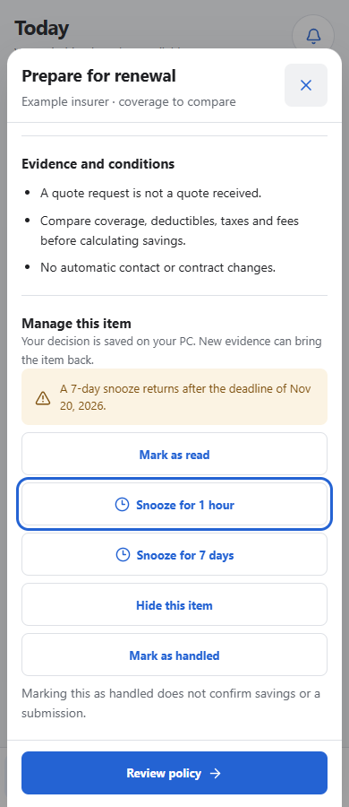

# Comité FamilyHub — reprise locale du 18 novembre 2026

## Canadian English review on 27 November 2026

PR #311 was reconciled with the published Canadian English interface at `0df94309b49033e440497d88129c1ce2f400fe8d`. The five 390 px images below were recaptured in English. The [before image](reviews/committee-20261118/before-390.png) uses a separate build of that exact main commit. The [320 px](reviews/committee-20261118/after-320.png) and [390 px](reviews/committee-20261118/after-390.png) after images show the same fictitious renewal in the candidate. The November 18 review below is historical.

Through **Today → Sources and options**, Playwright exercised 320, 360, 384, 390, 412, 768, 1280 and 1440 px. Both snooze controls referenced the deadline warning and had targets of at least 48 × 48 CSS pixels. The scenarios covered the return date and time, keyboard focus, persistence and restore, a rejected save, a lost acknowledgement, unknown deadlines and an unpaired device. The suite also checked both durations and a seven-day return on the deadline. All test sources and action records were synthetic. Physical-phone acceptance is still open.

Proposition implémentée sur branche isolée, destinée à une **PR en brouillon**. Suivi : #305; FH-PROACTIVE-003/004 et FH-UX-002. La décision de fusion/déploiement appartient à Kevin. Le comité automatique du même jour est repris ici, sans nouveau cycle programmé.

## Accès et périmètre réels

Le terminal Windows s’exécute sur kevinpc. La lecture PowerShell d’instructions d’un checkout extérieur est possible, mais Git en sandbox y répond `Permission denied`. Aucun ACL, compte, secret ou réglage de sécurité n’a été changé. Création/lecture/suppression d’un fichier fictif puis clone et branche Git réussissent dans `familyhub-committee-20261118`, sous le workspace autorisé de ce fil. Le DNS Git ordinaire était bloqué; le clone public a réussi par l’exécution réseau autorisée. Un worktree détaché de la même copie reproduit le code avant modification.

Base réelle : `3710eb1a29caecd06fa0d007277564a9f0915473`, publiée dans `release.json` le 18 novembre, après #306/#308/#310. Ces livraisons ne sont pas refaites. PR #304, les imports/collectes actifs, le worker installé et les données privées restent hors périmètre. La prochaine cadence existante n’a pas été changée. Aucun compte privé, mail, profil navigateur personnel ou dossier familial n’a été lu.

Conventions lues : AGENTS.md, REQUIREMENTS.md, README.md, docs/ARCHITECTURE.md, docs/PROACTIVE-ASSISTANT.md et suivi récent. Le registre ai-control-plane a servi uniquement au routage FamilyHub et au suivi. `PROJECT.yaml` est absent; l’identité du remote est `vdskevin009/familyhub`.

## Décisions antérieures préservées

- #291, catégories de Source récente, et #292, maquette annuelle d’offres : abandonnées selon la décision du 15 novembre; aucune reprise ni nouvelle déclinaison.
- #293 / FH-FIN-031 : captures récentes et historique partagent le registre, avec identités corroborées et lignes non rapprochées hors sous-total. Ce parcours n’est pas modifié.
- #307 / FH-UX-002 : priorité aux écrans existants visuels; nouvelles prévisions de trésorerie, réserves, journal de gains et politiques supplémentaires différées.
- #305 reste ouvert pour les exécutions naturelles et le téléphone physique. Les réparations #309/#310 ne prouvent pas ces résultats futurs.

La récupération des conversations personnelles était indisponible. La direction publiée et les décisions explicitement fournies sont utilisées; aucune préférence supplémentaire n’est déduite des anciennes propositions.

## Problème démontré et choix minimal

Une assurance **fictive** arrive à échéance à J+2. Dans Aujourd’hui, Sources et options proposait seulement « Reporter de 7 jours », sans avertissement de dépassement. Le test sur le code inchangé à 320/390 px a enregistré ce report dans une bibliothèque temporaire et constaté le retrait de la carte des prochaines actions. La décision gouverne déjà le rappel du même contrat et de la même date. De nouvelles preuves peuvent faire réapparaître la carte; sa disparition pendant sept jours entiers n’est pas garantie.

La fréquence réelle est inconnue. Le bénéfice attendu est une décision mieux informée et un moindre risque d’oubli, sans estimation de perte évitée, d’économies ou de temps gagné.

| Solution | Effort du parcours | Décision |
|---|---|---|
| Conserver seulement les sept jours | Deux actions depuis la carte; risque non explicité | Écartée après reproduction |
| Avertissement seul | Même parcours, seul délai long disponible | Alternative minimale utile mais sortie courte absente |
| Une heure et sept jours dans la feuille actuelle, avertissement contextualisé | Deux actions; choix volontaire, aucun écran/réglage supplémentaire | Retenue |
| Sélecteur de durée, calendrier ou confirmation supplémentaire | Choix et navigation supplémentaires | Écartés pour ce problème |

Le report long reste disponible. Le code ne déplace aucune échéance, n’invente pas d’heure limite, n’ajoute aucune politique Push et ne change pas le stockage serveur.

## Parcours complet et états

| État | Implémentation et preuve |
|---|---|
| Échéance à J+2 | Avertissement donnant la date avant les deux choix de report; une heure réutilise l’API actuelle |
| Échéance aujourd’hui/passée | Message distinct; aucun délai supplémentaire supposé |
| Une heure revient le jour de l’échéance | Heure limite explicitement inconnue, même pour le choix court |
| Échéance lointaine | Pas d’avertissement ajouté |
| Date absente/invalide | Reste inconnue; aucun retour présenté comme sûr |
| Enregistrement | Contrôles désactivés, une seule écriture pour double activation; confirmation après réponse |
| Conflit/échec | Feuille et actions conservées; message demandant une actualisation; pas de faux succès |
| Réponse perdue après écriture | Pas de POST automatique supplémentaire; la relecture retrouve la décision |
| Après report/rechargement | Badge court « Reportée », retour complet date/heure dans les métadonnées; restauration conservée |
| Connexion absente/chargement | Comportements existants conservés; sources inconnues et pistes gérées ne clignotent pas comme prêtes |

Le calendrier civil est `America/Vancouver`, cohérent avec les rappels existants. Les durées restent les délais écoulés déjà utilisés par le service. L’heure du retour s’affiche selon le navigateur. Les changements d’heure ne sont pas déduits d’un décalage fixe : [la Colombie-Britannique conserve UTC−7 depuis 2026](https://www2.gov.bc.ca/gov/content/governments/celebrating-british-columbia/daylight-saving-time), page officielle mise à jour le 23 mars 2026, consultée le 18 novembre.

## Visuels

Captures d’implémentation à 390 × 900 px, avec **les mêmes données entièrement fictives**. La baseline vient du worktree détaché à `3710eb1`. Il ne s’agit ni de captures familiales réelles ni d’une acceptation sur téléphone physique. Les feuilles sont défilées vers les commandes pertinentes.

| Avant | Proposition implémentée |
|---|---|
|  |  |

[Erreur conservant la feuille](reviews/committee-20261118/error-390.png) · [État non connecté](reviews/committee-20261118/empty-390.png) · [Retour daté dans les pistes gérées](reviews/committee-20261118/managed-390.png).

Aucun graphique ajouté : pour deux délais et une date, une phrase courte et des boutons nommés sont plus utiles qu’un nouvel axe/calendrier. Le badge chargé en texte a été raccourci, sans supprimer le retour exact ni les preuves.

## Comparaison de marché et utilité économique

Sources officielles consultées le **18 novembre 2026**; lecture documentaire, sans essai de compte ni copie d’interface propriétaire.

| Référence | Enseignement utile | Limite / décision FamilyHub |
|---|---|---|
| [Monarch — récurrents](https://help.monarch.com/hc/en-us/articles/4890751141908-Tracking-Recurring-Expenses-and-Bills), mise à jour 29 juin 2026 | Les détections et leurs dates/montants sont revus avant approbation | Une seule récurrence par marchand peut nécessiter des contournements; conserver les contrats distincts et les écrans existants, aucun nouveau calendrier |
| [Rocket Money — Premium+](https://help.rocketmoney.com/en/articles/17141357-bill-negotiations-is-moving-to-premium), 24 septembre 2026, effet 2 novembre | Action de renégociation reliée à une dépense, une demande en cours | Nouvelles demandes réservées à Premium+, sans commission de succès additionnelle; ancien accord applicable aux demandes déjà en cours. [Service réservé aux utilisateurs/banques US](https://help.rocketmoney.com/en/articles/79778-does-rocket-money-support-international-banks); aucune substitution canadienne ou prestation payante recommandée |

Deux pistes concrètes peuvent être examinées plus tard **dans les dossiers existants**, avec une autorisation de consulter leurs preuves :

- [ICBC — remise kilométrique](https://www.icbc.com/insurance/costs/distance-based-discount) : conditions possibles sur certaines garanties Optional sous 15 000 km/an (10–15 %) et Basic sous 5 000 km (10 %). Police annuelle et relevés espacés d’un an notamment requis. Admissibilité inconnue; aucun pourcentage appliqué à la prime familiale entière et aucune démarche effectuée.
- [CRTC — comparaison Internet](https://crtc.gc.ca/eng/internet/compare.htm), page du 10 septembre 2026 : vérifier prix après promotion et équipement dans la comparaison existante. Les nouvelles obligations décrites prennent effet le **10 mars 2027**, elles ne sont pas déjà en vigueur. Aucun tarif familial ou gain personnel n’est inféré.

Ces informations constituent des pistes de vérification, pas des économies établies. Les prix promotionnels, réductions brutes et résiduels d’assurance ne deviennent pas des gains réalisés.

## Revue d’interface et critique indépendante

Périmètre : Aujourd’hui → Sources et options → report → pistes gérées/restauration, dans le système React/TypeScript/Vite, boutons/dialogue natifs et tokens FamilyHub. Les autres écrans restent couverts par leurs régressions existantes, sans revue visuelle exhaustive revendiquée.

| Domaine | Preuves inspectées | Résultat borné |
|---|---|---|
| Accessibilité | Boutons natifs nommés, aria-describedby de l’avertissement, Tab/focus visible, Échap/retour, erreurs | Parcours ciblé vérifié; lecteur d’écran réel non vérifié |
| Structure | Quatre largeurs, commandes et pied de feuille accessibles, absence de débordement y compris retour long | Vérifié sur navigateur synthétique |
| Écriture | Dates/limites, confirmation après réponse, erreur récupérable, aucune économie inventée | Texte ajouté seulement dans le contexte utile |
| Typographie | Badge court, retour complet, avertissement 13 px / interligne 18,85 px | Captures relues à 320/390 px; zoom 200 % non certifié |
| Couleurs | Avertissement rgb(128,83,18) sur rgb(251,243,227) | Contraste rendu mesuré 6,015:1, symbole et texte redondants |
| UI | Contrôles de 48 px, composant Notice existant, état en cours et retour de focus | Aucun nouveau style, animation ou réglage |

| Gravité | Domaine | Emplacement | Avant | Après | Pourquoi |
|---|---|---|---|---|---|
| MEDIUM | Écriture/produit | TodayView.tsx:78 et options de report | Sept jours seulement, sans signal du dépassement | Choix court et avertissement lié à l’échéance affichée | Décision informée dans le même parcours |
| MEDIUM | Typographie | TodayView.tsx, carte gérée | Retour date/heure chargé dans un petit badge pendant le premier prototype | Badge « Reportée », retour entier dans les métadonnées existantes | Lisibilité à 320 px |

La revue produit/UX/marché a été confiée, comme demandé, à **gpt-6-astra avec effort xhigh**. Une seconde revue indépendante a inspecté code, hook/API et captures sans les modifier; aucun défaut introduit bloquant identifié pour une PR brouillon, sous réserve de CI exacte. Les avis IA ne sont pas comptés comme preuves empiriques indépendantes : tests et captures restent attribués à l’exécution principale.

**Limite préexistante conservée :** certaines classifications d’`opportunities.ts` utilisent encore la date UTC pour l’état/empreinte, tandis que les rappels utilisent Vancouver. Une soirée peut afficher un renouvellement « passé » dans un autre élément alors que l’avertissement dit « aujourd’hui ». Aucun changement global de dates, d’empreintes ou de décisions n’est inclus ici; ce sujet exige une vérification séparée. Aucune réapparition exclusivement à l’heure de retour n’est promise.

## Vérifications exécutées et limites

- Baseline inchangée : typechecks web/worker, build plugin-only; reproduction synthétique à 320/390 px, sans requête externe.
- Proposition : `npm run typecheck`, `VITE_MAIL_RETRIEVAL_MODE=plugin-only npm run build`, `npm run test:opportunities` (29), `npm run test:pwa`, `npm run test:notifications` (54), `node --test tests/ci-browser-shard.test.mjs` (5).
- `node apps/web/tests/proactive-browser.mjs` : nouveau parcours report à quatre largeurs puis parcours existant à six largeurs, liens exacts, persistance, erreurs/connexions partielles et navigation conservés.
- `node apps/web/tests/today-snooze-browser.mjs` : 320/390/768/1440; dates civiles, minuit, heure de retour, double activation, conflit/accusé perdu, restauration, source fictive inchangée. Source réseau extérieure interdite par le routage du test.
- Retour complet de la CI distante et SHA exact : consignés dans la PR brouillon liée à #305. La CI inclut .NET; SDK/exécution .NET locale indisponible, aucune installation ajoutée pour la revue.
- Non vérifiés : lecteur d’écran physique, téléphone, zoom 200 %, RTL, réapparition après une heure réellement écoulée et résultats financiers naturels. Les unités vérifient la réapparition à l’expiration; le navigateur vérifie le retour enregistré et le rechargement.

Les tests utilisent exclusivement des bibliothèques temporaires, un serveur local d’artefacts et une API fictive interceptée. Aucun worker installé, collecte, import réel, tâche, appareil Push, secret ou permission persistante n’est modifié. Les anciennes PR abandonnées ne sont pas réactivées.

**Verdict borné : Approve pour la préparation en PR brouillon, avec les limites ci-dessus.** Kevin choisit ensuite changements, abandon ou autorisation distincte de fusion/déploiement.
