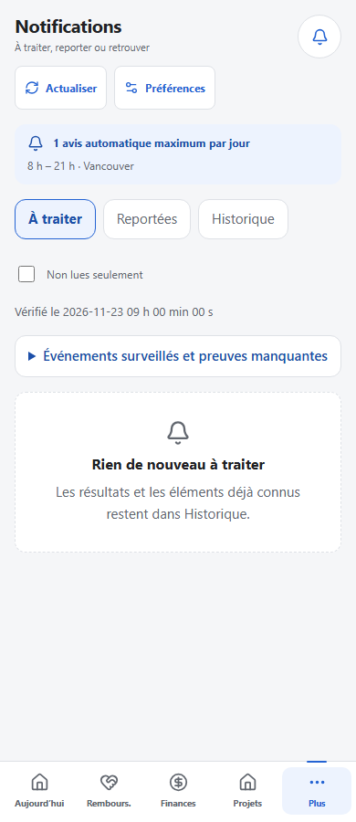
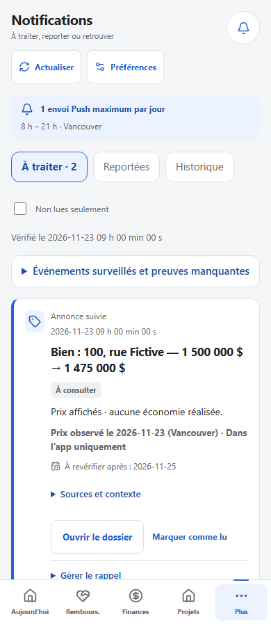

# Preuves synthétiques du 23 novembre

Captures d'implémentation Chromium, pas maquettes ni téléphone réel. API fictive interceptée ; aucun accès privé. Base avant : `3710eb1`; après : branche `review/committee-20261123`, source/build identifiés dans [provenance.json](provenance.json). [Résultat navigateur](acceptance.json), [résultat avant](before-result.json).

## Avant / après mobile

| Avant | Après |
|---|---|
|  |  |

L'historique existait dans chaque [dossier auto](before-history-vehicle-390.png) et [bien](before-history-property-390.png). Le nouveau centre présente les variations sans les appeler des économies.

## Détails et états

- [320 px](after-notifications-320.png), [390 px complet](after-notifications-390.png), [1440 px](after-notifications-1440.png). Les captures pleine page conservent la navigation fixe à sa position de capture ; ce n'est pas une image de téléphone défilante.
- Preuves [Auto](evidence-vehicle-390.png) / [Immobilier](evidence-property-390.png).
- Destinations exactes [Auto](destination-vehicle-390.png) / [Immobilier](destination-property-390.png).
- [Annonce absente](missing-390.png), [vide](empty-390.png), [erreur](error-390.png), [ancien worker](old-worker-390.png).

## Commandes et sorties

[typecheck](typecheck.log), [build](build.log), [63 tests notifications/contrats CI](notifications-models.log), [21 tests prix](project-model.log), [162 tests PWA/produit/transport](pwa.log), [nouveau navigateur](project-browser.log), [régressions navigateur](existing-browser.log), [construction du main](baseline-build.log). Le script avant ne produit pas de texte en réussite : résultat JSON et code retour vérifiés par l'opérateur.

La critique visuelle indépendante a inspecté huit captures finales, sans relancer les tests. Aucun défaut bloquant supplémentaire signalé. Ce contrôle ne couvre pas VoiceOver/TalkBack, téléphone physique, données réelles ou le candidat combiné avec #312.
