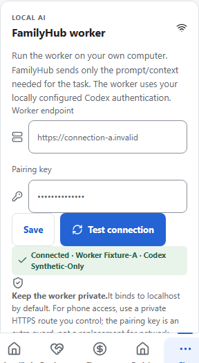
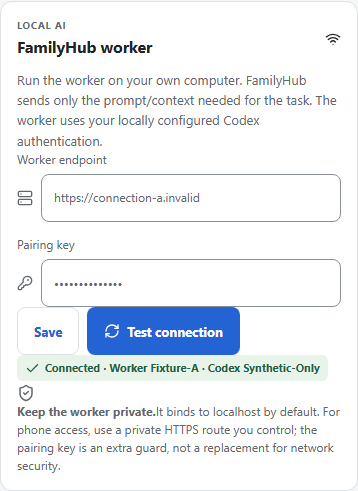
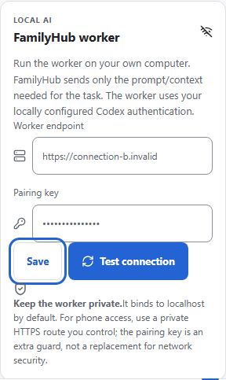
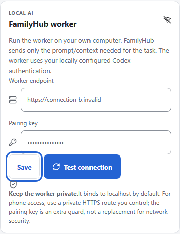
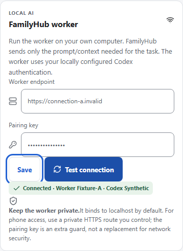
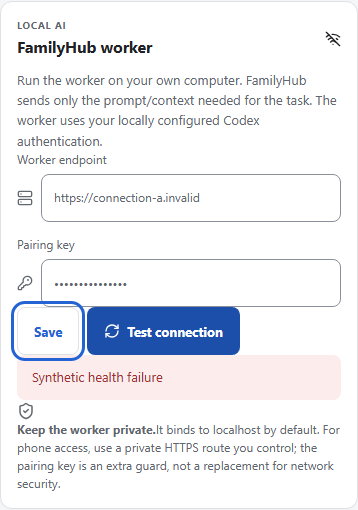

# Preuves visuelles — paramètres, 25 novembre 2026

Captures de l'implémentation, données entièrement fictives, aucun worker réel. Largeur du viewport indiquée ; panneau recadré pour lecture mobile. Les noms de domaines `.invalid` sont des substituts interceptés et la clé affichée est un faux champ masqué.

## Avant : une réponse de A remplace B déjà enregistré

Base `3710eb1a29caecd06fa0d007277564a9f0915473`. [Résultat de reproduction à 320 et 390 px](baseline-race.json).

| 320 px | 390 px |
|---|---|
|  |  |

## Après : B reste enregistré, aucun faux succès

Même enchaînement Test A → Save B → réponse A, dans le candidat de cette PR. [40 scénarios et assertions](acceptance.json).

| 320 px | 390 px |
|---|---|
|  |  |

## Le résultat courant continue de fonctionner

| Succès courant, 390 px | Erreur courante, 390 px |
|---|---|
|  |  |

État sans résultat : le panneau après Save ci-dessus n'affiche aucun résultat de test courant. Les cas d'édition non enregistrée, retour A → B → A et navigation sont dans le journal d'acceptation. Aucun test sur téléphone physique, lecteur d'écran ou réseau privé. Les copies de journaux sont synthétiques et identifient leurs commandes ; leur exécution locale est distincte de la CI distante liée dans la PR.
