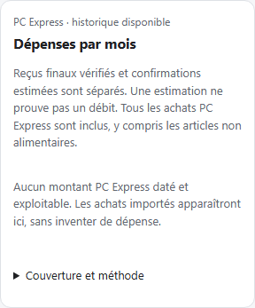
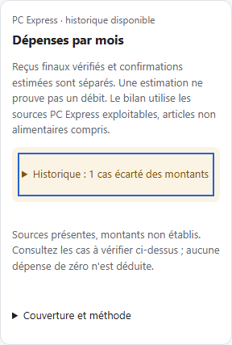
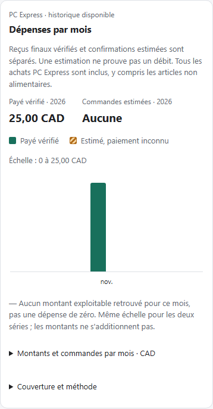
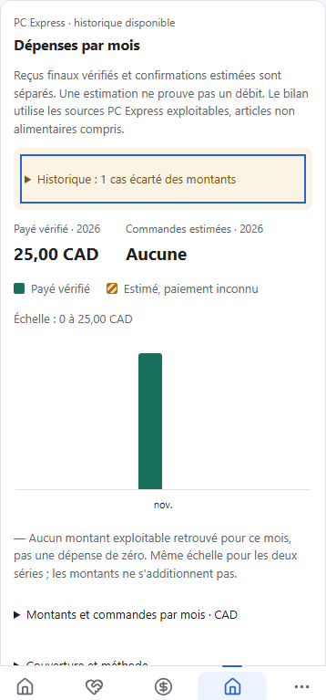
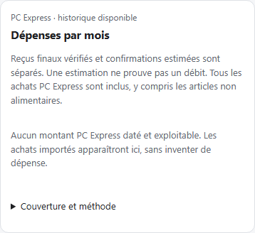
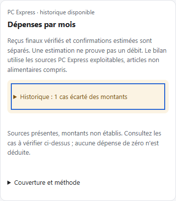

# Sources écartées — preuves synthétiques du 26 novembre

Captures de l'implémentation, pas maquettes ni téléphone réel. Viewports 320/390 px, panneau recadré. Données fictives exclusivement. Base avant : `c72eb6933ecf968a7c58dd97bd31f636dcb1e9d9` ; après : candidat de cette PR.

| Cas | Avant | Après |
|---|---|---|
| Tout écarté, 320 px |  |  |
| Partiel, 390 px |  |  |
| Tout écarté, 390 px |  |  |

[État réellement vide, 320 px](after-empty-320.png). Les états normal, zéro connu, ambiguïté, autre année/devise, cache et récupération sont dans le [résultat navigateur](acceptance.json). Le [résultat de reproduction](baseline.json) précède la correction.

[Fixtures de transport](../../../tests/fixtures/grocery-monthly-coverage.json) : readbacks produits par des helpers réels sur un répertoire temporaire fictif, puis conservés pour les tests navigateur. Le script navigateur intercepte les GET au niveau HTTP ; aucun endpoint familial n'est appelé. Aucune requête de modification n'est permise.

[Audit source/persistance/projection](order-evidence-results.json) : sept assertions supplémentaires. Script exact conservé : [order-evidence-audit.mjs](order-evidence-audit.mjs). Pour le reproduire depuis la racine isolée après `npm run build:worker`, créer `output/playwright/committee-20261126`, puis exécuter `node --import tsx docs/reviews/committee-20261126/order-evidence-audit.mjs`. Il crée son propre répertoire temporaire, le vérifie avant suppression et n'appelle ni réseau ni extracteur. Les expéditions multiples ne sont pas prises en charge arbitrairement.

Commandes locales du cycle :

- `npm run typecheck`, `npm run build`.
- `npm run test:pwa` : 162 réussis ; `node --test tests/ci-browser-shard.test.mjs` : 5 réussis.
- `node --test tests/pc-express-mail.test.mjs tests/grocery-auto-import.test.mjs` : 25 réussis.
- `node --import tsx --test tests/grocery-monthly-spending.test.ts` : 8 réussis.
- `node --import tsx --test --test-skip-pattern='isolated worker HTTP' tests/property-project.test.ts tests/vehicle-project.test.ts apps/web/tests/vehicle-api.test.ts` : 30 réussis, les deux scénarios HTTP exclus de cette commande.
- `npm run test:groceries:browser` : les sept scripts terminent avec succès ; le nouveau script couvre 36 scénarios, neuf cas à quatre largeurs. [Journal](groceries-browser.log).
- `npm run test:proactive:browser` : les cinq scripts terminent avec succès, dont Aujourd'hui, Auto/Immobilier et 40 scénarios de connexion. [Journal](proactive-browser.log).

Autres journaux conservés : [typecheck](typecheck.log), [build final](final-build.log), [PWA](pwa.log), [répartition CI](shards.log), [source/store](source-store-tests.log), [calcul mensuel](monthly-tests.log), [modèles Auto/Immobilier](project-models.log), [audit supplémentaire](order-evidence-audit.log). Les sommes SHA-256 de ces preuves sont conservées dans [provenance.json](provenance.json). Les contrôles locaux précèdent le commit ; la CI du SHA distant exact est un résultat séparé, indiqué dans la PR.

Limite locale conservée : une première exécution complète de `test:properties` a passé 13 tests et échoué à valider la connexion de son worker HTTP temporaire. Le `finally` l'a arrêté ; cause non établie, aucun worker installé touché. Le journal brut contenant des chemins temporaires n'est pas publié. La CI exacte reste une preuve distincte pour les scénarios HTTP et .NET.

Les premières tentatives du nouveau test ont révélé deux défauts du harnais : sélecteur ne reconnaissant pas l'apostrophe typographique et assertion avant la fin du chargement initial. Ils ont été corrigés après inspection, sans clic forcé ni retry. La critique Astra a également renforcé la reconnexion : réponse 200 attendue et nouveau jeu fictif rendu à la place du cache. Aucun résultat abandonné n'est compté comme réussite.
